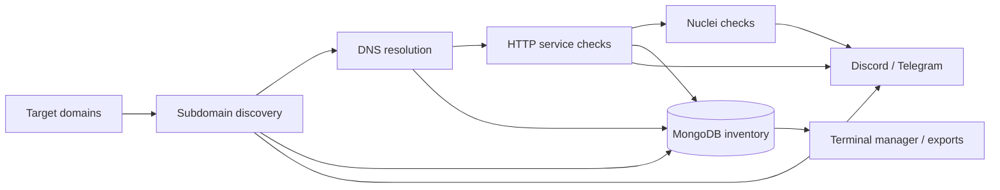

# WatchTower

**Keep watch over your attack surface as it changes.**

WatchTower is a Python reconnaissance and attack surface monitoring toolkit for security researchers and bug bounty workflows. It brings recurring subdomain discovery, DNS resolution, HTTP service checks, and Nuclei scans into one workflow, with findings stored in MongoDB and notifications delivered through Discord and Telegram.

Use it to build an inventory of your targets, discover newly exposed services, and follow changes over time.

## What it does

- **Discover subdomains** with Subfinder, certificate transparency data from crt.sh, and SecurityTrails.
- **Resolve discovered names** with ShuffleDNS and wordlists, including integrations for DNSGen, Altdns, and AlterX.
- **Track HTTP services** and compare status codes, page titles, detected technologies, and response body hashes.
- **Run Nuclei checks** against newly discovered assets and integrate new template checks.
- **Send notifications** for discoveries, HTTP changes, scan results, and runtime errors.
- **Explore your inventory** through a terminal manager with searches, exports, target management, and settings.



## Interactive setup

Start the guided terminal interface:

```bash
python3 launcher.py
```

The launcher opens with a WatchTower ASCII eye banner, with a red pupil in colour terminals and a compact version for narrow windows. Preview it with `python3 launcher.py --banner`. Set `NO_COLOR=1` for plain text.

The launcher uses the project's virtual environment when one is available. Choose a saved target or enter a domain, add an optional report URL and exact subdomain exclusions, and select a discovery schedule:

- **Quick discovery test:** Subfinder every minute.
- **Recurring discovery:** Subfinder every three hours.
- **Custom interval:** Choose a number of minutes, hours, or days.

Choose whether to send Discord notifications. If credentials are missing, the launcher asks for one webhook without displaying it and saves it in the ignored `.env` file. Telegram credentials are optional.

Select **Save and start** to write `targets.json` and `setting.json`, start MongoDB through Docker Compose, and run WatchTower with live terminal output and an appended `files/watchtower.log`. The first discovery runs after the interval you selected. Press **Ctrl+C** to stop monitoring.

This setup selects one target and disables other discovery jobs and Nuclei scans. Each saved setup creates a backup of the previous configuration in `files/config-backups/`. If another session is running, the launcher offers to stop it before saving. You can also choose **Save setup only** or **Cancel**.

Docker and Subfinder must already be installed. Install Python dependencies once with `.venv/bin/python -m pip install -r requirements.txt` after creating the virtual environment described below. The launcher supports macOS and Linux.

## Requirements

WatchTower uses Python, MongoDB, and external command-line tools. Install the tools needed by the jobs you enable and make sure they are available on your `PATH`.

| Component | Purpose |
| --- | --- |
| Python 3.10+ recommended | Runs the scheduler and terminal manager |
| MongoDB at `mongodb://localhost:27017/` | Stores discovered assets and service metadata |
| Docker with Compose | Runs MongoDB using the included configuration |
| Subfinder | Subdomain discovery |
| PostgreSQL client (`psql`) | crt.sh certificate transparency queries |
| ShuffleDNS and MassDNS | DNS resolution and wordlist checks |
| ProjectDiscovery httpx | HTTP probing; this is the ProjectDiscovery CLI |
| Nuclei and Git | Scanning and template retrieval |
| DNSGen, Altdns, AlterX | Dynamic subdomain permutations |

SecurityTrails also requires an API key. DNS jobs require a resolver list at `~/.resolvers`, a static wordlist at `wordlist/static.txt`, and, for dynamic resolution, a permutation wordlist at `wordlist/gen_alt.txt`. Supply these files before enabling the corresponding jobs.

## Manual setup

### 1. Install Python dependencies

```bash
git clone https://github.com/OmidRahmanian/Watchtower.git
cd Watchtower
python3 -m venv .venv
source .venv/bin/activate
python -m pip install -r requirements.txt
mkdir -p files export output wordlist
```

### 2. Start MongoDB

```bash
docker compose up -d mongodb
```

If your installation provides the standalone Compose command, use `docker-compose up -d mongodb`.

### 3. Configure notifications

For manual setup, create a local `.env` file with your credentials. `./run.sh` loads it automatically; load it into your shell before running the Python backend directly.

One Discord webhook can serve every notification category. Separate webhooks can route categories to different channels.

```bash
DISCORD_WEBHOOK_URL='https://discord.com/api/webhooks/YOUR_WEBHOOK_ID/YOUR_WEBHOOK_TOKEN'
NEW_SUB_WEBHOOK_URL="$DISCORD_WEBHOOK_URL"
NEW_RES_WEBHOOK_URL="$DISCORD_WEBHOOK_URL"
HTTP_CHANGE_WEBHOOK_URL="$DISCORD_WEBHOOK_URL"
NEW_HTTP_WEBHOOK_URL="$DISCORD_WEBHOOK_URL"
NUCLEI_WEBHOOK_URL="$DISCORD_WEBHOOK_URL"
OTHER_WEBHOOK_URL="$DISCORD_WEBHOOK_URL"

TELEGRAM_CHAT_ID='YOUR_CHAT_ID'
TELEGRAM_BOT_TOKEN='YOUR_BOT_TOKEN'
NEW_SUB_TELEGRAM_TOKEN="$TELEGRAM_BOT_TOKEN"
NEW_RES_TELEGRAM_TOKEN="$TELEGRAM_BOT_TOKEN"
HTTP_CHANGE_TELEGRAM_TOKEN="$TELEGRAM_BOT_TOKEN"
NEW_HTTP_TELEGRAM_TOKEN="$TELEGRAM_BOT_TOKEN"
NUCLEI_TELEGRAM_TOKEN="$TELEGRAM_BOT_TOKEN"
OTHER_TELEGRAM_TOKEN="$TELEGRAM_BOT_TOKEN"

# Required when using SecurityTrails; multiple keys are comma-separated.
SECURITYTRAILS_API_KEYS='YOUR_SECURITYTRAILS_API_KEY'
```

`watch.py` requires the six Discord variables when `sendmessage` is enabled. Disabling that setting turns off notifications and allows discovery without webhook credentials. Telegram is optional: configure its chat ID and the tokens for the categories you want to receive. The same Telegram bot token can serve each category. `start.py` requires its Discord variables independently of the notification switch.

Load the configuration:

```bash
chmod 600 .env
set -a
source .env
set +a
```

`.env` is ignored by Git. Keep real webhook URLs, bot tokens, and API keys in that local file.

### 4. Set your targets

Replace the sample domains in `targets.json` with your own scope:

```json
{
  "example.com": {
    "report_url": "https://example.com/security",
    "out_of_scope": [
      "excluded.example.com"
    ]
  }
}
```

`targets.json` drives recurring monitoring. `starttargets.json` supplies domains for the separate initial collection script. The `out_of_scope` checks compare exact subdomain strings; they do not expand wildcard patterns.

### 5. Choose your jobs

Edit `setting.json` to enable integrations you have configured. Each recurring job has a `status`, a numeric `value`, and a `time` unit such as `hours`, `days`, or `weeks`:

```json
"subfinder": {
  "time": "hours",
  "value": "3",
  "status": "enable"
}
```

This is an entry inside the settings object. Use `"status": "disable"` for jobs with missing tools or credentials.

The sample intervals schedule Subfinder, crt.sh, and SecurityTrails every three hours; DNS resolution every six hours; static wordlist resolution every three days; dynamic resolution weekly; and HTTP checks and new template checks daily. Each job also needs its status set to `enable` to run. The interactive discovery setup replaces these with your chosen Subfinder interval and disables the other jobs.

Additional settings control notifications, HTTP change comparisons, scanning new assets, and the Nuclei command arguments.

### 6. Run WatchTower

From the project directory, with the virtual environment active and credentials loaded:

```bash
python -u watch.py
```

The scheduler waits until each job's first interval has elapsed. Starting it does not immediately run a full scan. Keep the process running to execute scheduled jobs.

For an initial collection, configure `starttargets.json` and run:

```bash
python -u start.py
```

`start.py` runs its collection pipeline immediately, including SecurityTrails, and requires that pipeline's dependencies and API key. After a successful run, it merges those targets into `targets.json`.

## Manage findings

Open the terminal manager in another shell:

```bash
source .venv/bin/activate
python manager.py
```

The menu supports exporting discovered, resolved, and HTTP assets; searching by subdomain, status code, technology, or title; querying records; editing targets; and updating settings. Exports are written to `export/`.

## Project layout

| File or directory | Role |
| --- | --- |
| `launcher.py` | Interactive target selection, discovery setup, MongoDB startup, and live logs |
| `session.py` | Prevents overlapping monitoring and setup sessions |
| `run.sh` | Starts the backend with local environment credentials |
| `requirements.txt` | Python dependencies |
| `watch.py` | Recurring monitoring scheduler and notification integrations |
| `start.py` | Initial collection pipeline |
| `manager.py` | Interactive terminal manager |
| `setting.json` | Job intervals, feature switches, and scan options |
| `targets.json` | Recurring monitoring scope |
| `starttargets.json` | Initial collection scope |
| `docker-compose.yml` | MongoDB service and persistent storage |
| `wordlist/` | User-supplied DNS wordlists |
| `files/` | Working files |
| `export/` | Exported inventories |
| `data/` | Local MongoDB storage and backup paths |

## Operational notes

WatchTower is an early version that coordinates external tools. Check each enabled integration with your installed tool versions before relying on unattended monitoring.

- A startup error naming a missing webhook means Discord is enabled without complete credentials. Run `python3 launcher.py` to configure it or choose discovery without notifications.
- MongoDB must be reachable at `localhost:27017` before collection or inventory queries run.
- `SECURITYTRAILS_API_KEYS is not configured` means the SecurityTrails job needs credentials or should be disabled in the recurring scheduler.
- `./run.sh` starts the backend with the saved setup and credentials. Use the interactive launcher when you also want MongoDB started automatically.
- Run commands from the repository directory because the scripts use relative paths for settings and working files.

Use WatchTower within the scope of systems you own or are authorized to assess.

