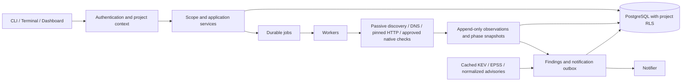

# Architecture

WatchTower is a modular Python application with PostgreSQL as its system of
record. CLI commands, the terminal home and the FastAPI dashboard use the same
scope, inventory, finding and run services. The original MongoDB scripts remain
a separate legacy workflow; editing their JSON files does not change platform
scope.

Every job pins a scope revision. Live policy decisions reload that revision
before DNS queries and HTTP/check connections, bypassing the UI policy cache.
Revocation, supersession and authorization windows fail closed. Every address
in a resolved set must pass the destination policy, and sockets connect to an
approved IP with the original hostname used for Host/SNI. Redirect following
is off by default; opting in still checks every hop.

Shared PostgreSQL counters bound DNS/HTTP/check requests across worker processes:
per hostname, per project, globally per minute and cumulatively per run. Minute
windows can burst up to their configured cap; they are not evenly spaced
requests. Waiting is cancellable and rechecks authorization. Passive Subfinder
provider traffic is bounded by its timeout/output limits and provider settings,
not these target-request counters. The counter table contains opaque hashes
and is system-owned; no API exposes its rows.

Run creation supports durable, principal/project-bound idempotency keys and
optional reuse of equivalent active scans. A project advisory lock serializes
the check and enqueue. Reused request keys stay mapped to the same run after
completion. Reusing a key with different parameters or scope returns a conflict.

State comparisons use completed phase snapshots, preserve uncertain items,
debounce modifications and do not interpret failed scans as removals. Evidence
is bounded and redacted before content-addressed storage. Only a relevant,
conclusive negative retest resolves a finding. Workflow status, detection,
confidence, severity and explainable priority remain separate.

Intelligence refresh is an explicit owner command; outages preserve cached
snapshots and freshness warnings. Correlation uses exact curated product
identities and comparable versions, preserving unknown versions and unverified
platform prerequisites. It creates applicability-review output rather than
claiming an exploit was validated. Approved component checks can consume the
cache; unavailable configured feeds are reported as missing coverage. No feed
refresh automatically starts a public-target scan.

The dashboard uses plain JavaScript rather than React/TypeScript. Native pinned
HTTP and reviewed native checks provide the current platform probe/check
implementation rather than delegating arbitrary requests to httpx/Nuclei.
Those are deliberate implementation choices, not claims of equivalent template
coverage. The old httpx/Nuclei integrations remain legacy-only.

For laptop use, a scan window runs the local worker while Home remains usable.
For deployment, Celery/RabbitMQ wake durable PostgreSQL jobs. The production
Compose overlay adds a firewall namespace shared by workers/notifier. Only its
bootstrap guard has NET_ADMIN; scanning processes have no capabilities or
Docker socket. IPv4 private/reserved/metadata ranges are blocked after exact
database/broker/DNS exceptions; other outbound traffic is limited to TCP 80/443.
IPv6 egress is disabled in this deployment until an equivalent allowlist is
configured. Native laptop processes have the application guard, not this OS
container boundary. See [deployment](../deploy/README.md).
